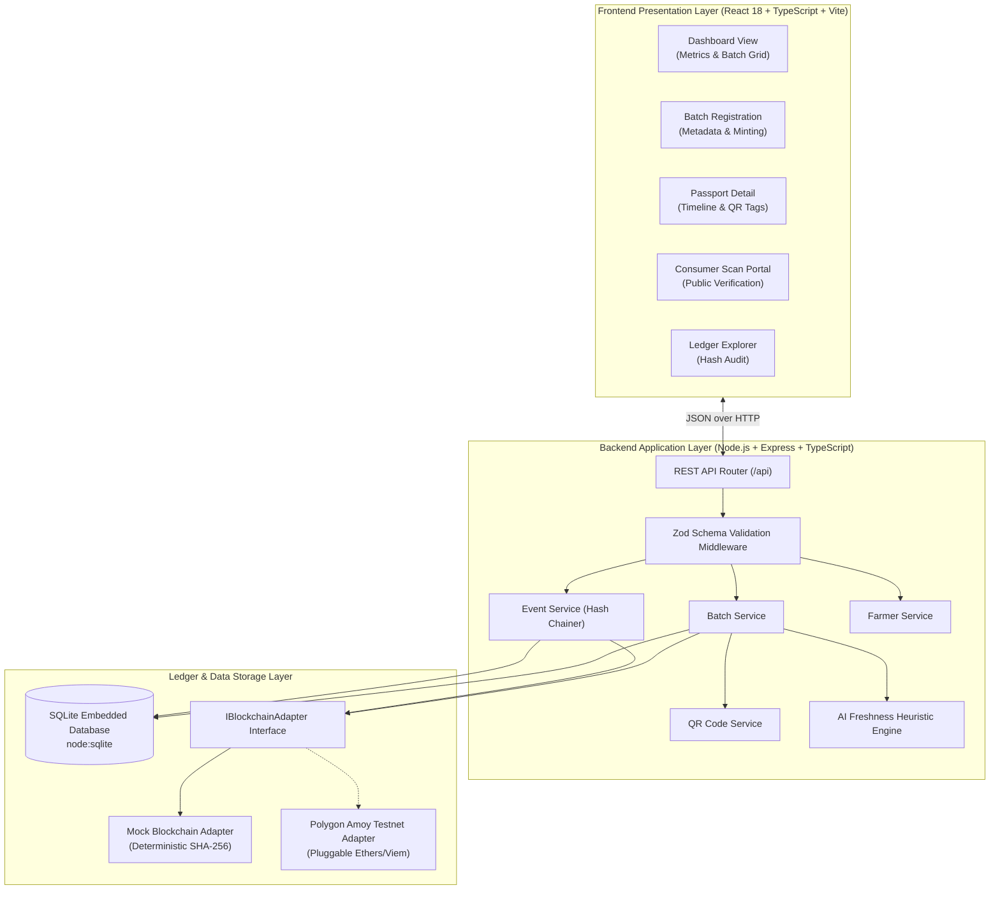
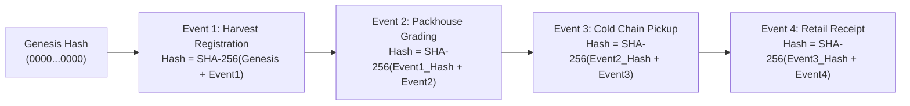

# AgriPassport System Architecture

This document provides a comprehensive technical overview of the system architecture, component responsibilities, and data flows of **AgriPassport: AI-Powered Blockchain Digital Passport for Farm-to-Fork Traceability**.

---

## 1. High-Level Architectural Diagram

---

## 2. Layer Responsibilities

### A. Presentation Layer (Frontend)
- **Framework**: React 18, TypeScript, Vite.
- **Styling**: Modern responsive CSS variables with mobile-first layouts.
- **Responsibilities**:
  - Render produce passports, status pills, and interactive timelines.
  - Display dynamic crate QR codes and handle printable tag formatting.
  - Display visual freshness gauges with clear educational disclaimers.
  - Provide a consumer-facing scan interface that requires no authentication.

### B. Application & Domain Layer (Backend)
- **Framework**: Express, Node.js v24, TypeScript.
- **Responsibilities**:
  - Request validation using Zod schemas (`createBatchSchema`, `createEventSchema`).
  - Generate unique batch identifiers (`AGRI-BATCH-YYYY-XXXX`).
  - Calculate SHA-256 cryptographic hashes chaining each event to its predecessor.
  - Compute heuristic freshness index and remaining shelf-life days.
  - Generate Base64 PNG and SVG dynamic QR codes.

### C. Ledger & Persistence Layer
- **Relational Storage**: SQLite via Node's native `node:sqlite` module.
- **Blockchain Adapter (`IBlockchainAdapter`)**:
  - Decouples business logic from specific blockchain implementations.
  - **Mock Mode (Default)**: Generates deterministic Ethereum/Polygon-formatted transaction hashes (`0x...`), increments simulated block numbers, and anchors hashes into a local ledger registry.
  - **Live Mode (Pluggable)**: Ready to connect to Polygon Amoy testnet RPC using smart contracts.

---

## 3. Cryptographic Event Chain Architecture

To ensure tamper-evidence without incurring gas costs for student testing, each event computes a SHA-256 hash linking the previous event's hash to the current event payload:

If any historical record is modified, all subsequent hashes break, immediately exposing the tampering during verification.
