# AgriPassport Database Schema Documentation

This document describes the relational database schema implemented for **AgriPassport: AI-Powered Blockchain Digital Passport for Farm-to-Fork Traceability**.

The system utilizes an embedded **SQLite** database (`node:sqlite`) for local development, reproducible student evaluations, and fast testing.

---

## Entity-Relationship (ER) Diagram

```mermaid
erDiagram
    FARMERS ||--o{ BATCHES : registers
    BATCHES ||--o{ TRACEABILITY_EVENTS : contains
    BATCHES ||--o| BLOCKCHAIN_ANCHORS : anchors
    TRACEABILITY_EVENTS ||--o| BLOCKCHAIN_ANCHORS : anchors

    FARMERS {
        text farmer_id PK
        text name
        text fpo_name
        text village
        text district
        text state
        text gps_coordinates
        integer organic_certified
        text contact_placeholder
        integer is_fictional_demo
        text created_at
    }

    BATCHES {
        text batch_id PK
        text farmer_id FK
        text farmer_name
        text crop_name
        text variety
        text harvest_date
        text farm_location
        text gps_coordinates
        real quantity
        text unit
        text grade
        text cultivation_method
        text storage_conditions
        real initial_freshness_score
        integer estimated_shelf_life_days
        text current_status
        text created_at
        integer is_fictional_demo
    }

    TRACEABILITY_EVENTS {
        text event_id PK
        text batch_id FK
        text event_type
        text timestamp
        text location
        text actor_name
        text actor_role
        real temperature_celsius
        real humidity_percentage
        text notes
        text record_hash
        text previous_record_hash
        text blockchain_tx_hash
        integer is_fictional_demo
        text created_at
    }

    BLOCKCHAIN_ANCHORS {
        text record_hash PK
        text entity_type
        text entity_id
        text tx_hash
        integer block_number
        text network
        integer is_mock
        text timestamp
    }
```

---

## Table Definitions

### 1. `farmers` Table
Stores details of registered smallholder farmers and Farmer Producer Organizations (FPOs).

| Column Name | Data Type | Constraints | Description |
| :--- | :--- | :--- | :--- |
| `farmer_id` | `TEXT` | `PRIMARY KEY` | Unique farmer identifier (e.g., `FARM-TN-101`) |
| `name` | `TEXT` | `NOT NULL` | Full name of the farmer |
| `fpo_name` | `TEXT` | `NOT NULL` | Affiliated Farmer Producer Organization / Cooperative |
| `village` | `TEXT` | `NOT NULL` | Village / Town of the farm |
| `district` | `TEXT` | `NOT NULL` | District (e.g., Krishnagiri, Theni, Salem) |
| `state` | `TEXT` | `NOT NULL` | State (e.g., Tamil Nadu) |
| `gps_coordinates`| `TEXT` | `NOT NULL` | Lat/Long GPS string (e.g., `12.5266, 78.2148`) |
| `organic_certified`| `INTEGER`| `DEFAULT 0` | Boolean flag (1 = Certified Organic, 0 = Conventional/GAP) |
| `contact_placeholder` | `TEXT` | `NULLABLE` | Anonymized contact string for student privacy |
| `is_fictional_demo` | `INTEGER`| `DEFAULT 1` | Indicates fictional demonstration data |
| `created_at` | `TEXT` | `NOT NULL` | ISO 8601 creation timestamp |

---

### 2. `batches` Table
Stores registered produce consignments. Each batch represents a distinct harvest lot.

| Column Name | Data Type | Constraints | Description |
| :--- | :--- | :--- | :--- |
| `batch_id` | `TEXT` | `PRIMARY KEY` | Unique batch passport ID (e.g., `AGRI-BATCH-2026-TOM01`) |
| `farmer_id` | `TEXT` | `NOT NULL, FK` | References `farmers(farmer_id)` |
| `farmer_name` | `TEXT` | `NOT NULL` | Snapshot of farmer name |
| `crop_name` | `TEXT` | `NOT NULL` | Crop commodity (e.g., Roma Tomatoes, Bananas) |
| `variety` | `TEXT` | `NOT NULL` | Botanical cultivar / trade variety (e.g., AP-TOM-01) |
| `harvest_date` | `TEXT` | `NOT NULL` | ISO 8601 harvest date and time |
| `farm_location` | `TEXT` | `NOT NULL` | Resolved origin location |
| `gps_coordinates`| `TEXT` | `NOT NULL` | Point of origin GPS coordinate |
| `quantity` | `REAL` | `CHECK(quantity > 0)` | Net weight or crate count |
| `unit` | `TEXT` | `NOT NULL` | Unit of measure (`kg`, `ton`, `crate`, `box`) |
| `grade` | `TEXT` | `NOT NULL` | Quality tier (`Grade A`, `Grade B`, `Export Grade`) |
| `cultivation_method` | `TEXT` | `NOT NULL` | Farming practice (e.g., GAP Certified, Organic) |
| `storage_conditions` | `TEXT` | `NOT NULL` | Recommended temperature & RH storage parameters |
| `initial_freshness_score` | `REAL` | `DEFAULT 95.0` | Freshness rating at harvest (0.0 to 100.0) |
| `estimated_shelf_life_days` | `INTEGER` | `DEFAULT 7` | Expected shelf-life under optimal cold chain |
| `current_status` | `TEXT` | `NOT NULL` | `HARVESTED`, `PACKHOUSE_GRADED`, `IN_TRANSIT`, `COLD_STORAGE`, `DISTRIBUTION_HUB`, `RETAIL_READY` |
| `created_at` | `TEXT` | `NOT NULL` | ISO 8601 creation timestamp |
| `is_fictional_demo` | `INTEGER` | `DEFAULT 1` | Flags fictional demo record |

---

### 3. `traceability_events` Table
Represents chronological custody checkpoints across the supply chain. Events are cryptographically linked using SHA-256 hashes (`previous_record_hash`).

| Column Name | Data Type | Constraints | Description |
| :--- | :--- | :--- | :--- |
| `event_id` | `TEXT` | `PRIMARY KEY` | Unique event ID (e.g., `EVT-TOM01-01`) |
| `batch_id` | `TEXT` | `NOT NULL, FK` | References `batches(batch_id)` ON DELETE CASCADE |
| `event_type` | `TEXT` | `NOT NULL` | Checkpoint category (`HARVEST_REGISTRATION`, `PACKHOUSE_GRADING`, `COLD_CHAIN_PICKUP`, etc.) |
| `timestamp` | `TEXT` | `NOT NULL` | ISO 8601 timestamp of checkpoint execution |
| `location` | `TEXT` | `NOT NULL` | Physical location (packhouse, highway toll, hub) |
| `actor_name` | `TEXT` | `NOT NULL` | Individual or logistics enterprise executing the event |
| `actor_role` | `TEXT` | `NOT NULL` | `FARMER`, `FPO_QUALITY_INSPECTOR`, `TRANSPORTER`, `STORAGE_OPERATOR`, `AGGREGATOR`, `RETAILER` |
| `temperature_celsius` | `REAL` | `NULLABLE` | Ambient sensor temperature reading (°C) |
| `humidity_percentage` | `REAL` | `NULLABLE` | Ambient relative humidity reading (% RH) |
| `notes` | `TEXT` | `NOT NULL` | Operational observations, optical grading notes |
| `record_hash` | `TEXT` | `NOT NULL` | SHA-256 hash of `(previous_hash + payload)` |
| `previous_record_hash` | `TEXT` | `NOT NULL` | Hash of the previous event (genesis = `0000...`) |
| `blockchain_tx_hash` | `TEXT` | `NULLABLE` | Transaction hash returned from blockchain adapter |
| `is_fictional_demo` | `INTEGER` | `DEFAULT 1` | Flags fictional demo record |
| `created_at` | `TEXT` | `NOT NULL` | ISO 8601 creation timestamp |

---

### 4. `blockchain_anchors` Table
Maintains the registry of all hashes anchored onto the blockchain adapter (mocked or testnet).

| Column Name | Data Type | Constraints | Description |
| :--- | :--- | :--- | :--- |
| `record_hash` | `TEXT` | `PRIMARY KEY` | The 64-character SHA-256 hash anchored |
| `entity_type` | `TEXT` | `NOT NULL` | Target type: `'BATCH'` or `'EVENT'` |
| `entity_id` | `TEXT` | `NOT NULL` | Target entity identifier |
| `tx_hash` | `TEXT` | `NOT NULL` | Transaction hash (`0x...`) |
| `block_number` | `INTEGER` | `NOT NULL` | Simulated or live block height |
| `network` | `TEXT` | `NOT NULL` | Network identifier (e.g., `Polygon Amoy Testnet (Simulated)`) |
| `is_mock` | `INTEGER` | `DEFAULT 1` | 1 = Simulated Local Mock, 0 = Live Testnet |
| `timestamp` | `TEXT` | `NOT NULL` | ISO 8601 anchoring timestamp |

---

## Indexes & Constraints

- `idx_batches_farmer`: Optimizes filtering batches by farmer ID.
- `idx_batches_status`: Optimizes dashboard filtering by produce lifecycle state.
- `idx_events_batch_timestamp`: Composite index ensuring chronological ordering of event histories.
