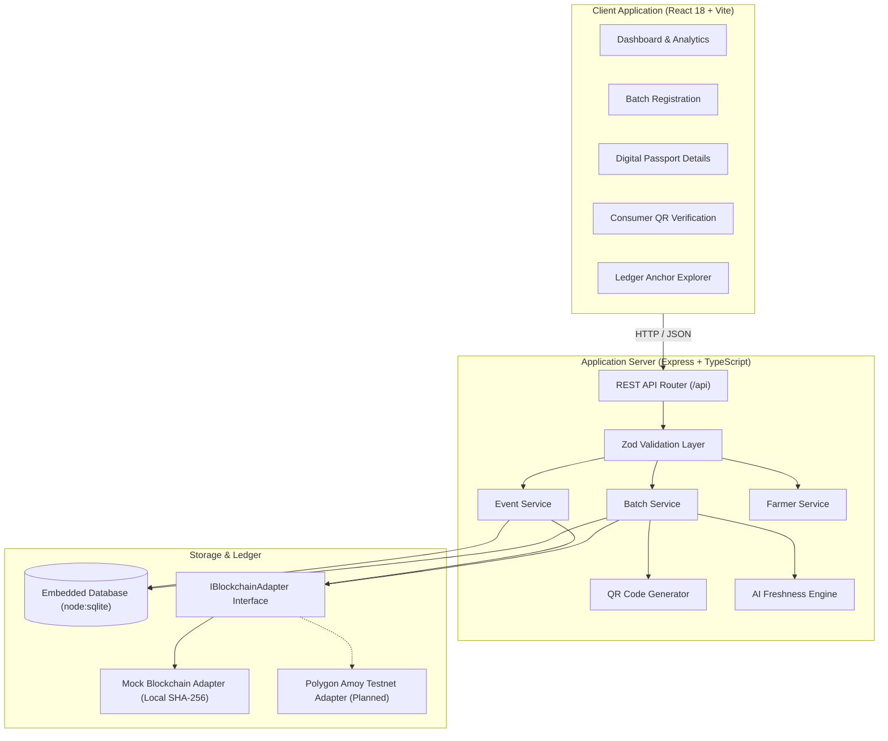
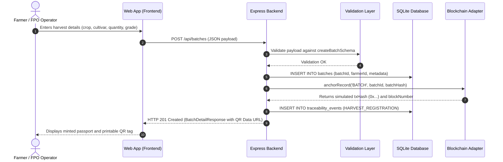
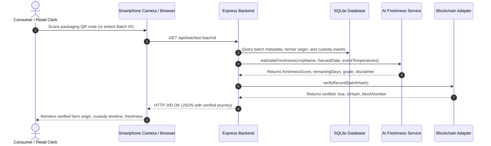
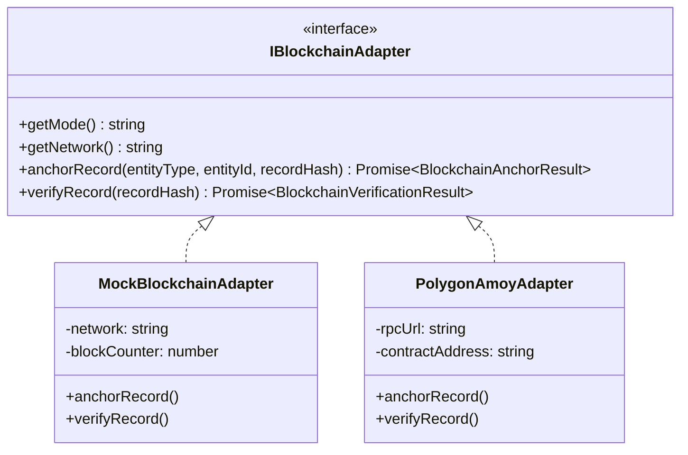

# AgriPassport Technical Design Document

**Project Title:** AgriPassport: AI-Powered Blockchain Digital Passport for Farm-to-Fork Traceability  
**Institution:** Sri Sairam Engineering College  
**Department:** Computer Science and Engineering  
**Course:** Innovative Design Lab–I (Batch 2025–2029)  
**Authors:** Dharun Vijay M (2503412510421063), Bharani R (2503412510421047), Mithilesh N (2503412510421159)

---

## 1. Document Purpose and Scope
This document details the engineering specifications, architectural patterns, cryptographic protocols, database structures, and component designs of the **AgriPassport** platform. It serves as the authoritative blueprint for developers, academic evaluators, and future contributors.

---

## 2. Project Overview
AgriPassport is a digital provenance and food-quality platform designed for fresh horticultural supply chains. By combining lightweight web interfaces, dynamic crate QR codes, cryptographic event hashing, and AI-assisted freshness estimation, the platform enables end-to-end traceability from the farm packing shed to the consumer retail shelf.

---

## 3. Problem Statement and Design Goals

### Problem Statement
Over 35% of fresh horticultural produce in India spoils before reaching retail shelves, leading to over ₹89,000 Crore of avoidable economic loss annually. Supply chains suffer from information opacity, subjective mandi grading, unverified harvest dates, and blind transit corridors where temperature abuse goes undetected until wholesale cross-docking.

### Design Goals
1. **Verifiable Provenance**: Guarantee cryptographic tamper-evidence of harvest origin and handling records.
2. **Accessible Frictionless Scanning**: Allow consumers and retail clerks to audit produce history without downloading mobile apps.
3. **Reproducible Local Execution**: Enable student researchers to run the full stack locally with zero paid subscriptions or external node dependencies.
4. **Honest Technical Boundaries**: Clearly demarcate **Implemented** components from **Mocked** integrations and **Planned** expansions.

---

## 4. Functional Requirements
- **FR-1 [Implemented] Batch Registration**: Authorize users to register produce consignments with crop name, cultivar, harvest timestamp, quantity, grade, and GPS origin.
- **FR-2 [Implemented] Dynamic QR Tagging**: Automatically generate Base64 PNG and SVG QR codes encoding verification URLs.
- **FR-3 [Implemented] Checkpoint Event Logging**: Enable supply-chain participants to record handling events (harvest, grading, cold chain loading, transit checkpoints, retail delivery).
- **FR-4 [Implemented] Cryptographic Hash Chaining**: Link every event to its predecessor using SHA-256 hashes to construct an immutable event chain.
- **FR-5 [Implemented] Blockchain Ledger Anchoring (Mocked)**: Record and verify transaction hashes via a pluggable adapter interface.
- **FR-6 [Implemented] AI Freshness Heuristic Engine**: Estimate freshness score, remaining shelf-life days, and grade classification based on cultivar characteristics and temperature exposure.
- **FR-7 [Implemented] Consumer Verification Portal**: Public interface allowing consumers to inspect harvest history, farm origin, and cold chain custody.
- **FR-8 [Implemented] Ledger Explorer**: Verification utility to audit any 64-character SHA-256 record hash against anchored transactions.

---

## 5. Non-Functional Requirements
- **NFR-1 Performance**: API response latency under 200 ms for batch lookups and QR generation.
- **NFR-2 Portability**: Standard TypeScript codebase running natively on Node.js v20+ with zero C++ native compile requirements.
- **NFR-3 Reliability**: In-memory SQLite mode for instantaneous test execution and persistent SQLite file storage for local development.
- **NFR-4 Usability**: Responsive design supporting desktop monitors, tablets, and smartphone screens.
- **NFR-5 Security**: Strict input validation using Zod schemas; parameterized SQL queries to prevent SQL injection.

---

## 6. System Architecture

---

## 7. Component Responsibilities & Implementation Status

| Component | Responsibility | Current Status |
| :--- | :--- | :--- |
| **Frontend UI** | Responsive web client, dashboards, timelines, QR rendering | **Implemented** |
| **Backend REST API** | Express routing, controllers, error middleware, business logic | **Implemented** |
| **Input Validation** | Zod schemas rejecting malformed payloads on the server | **Implemented** |
| **SQLite Database** | Relational persistence of farmers, batches, and event chains | **Implemented** |
| **QR Generation** | Base64 PNG and SVG encoding of verification URLs | **Implemented** |
| **AI Freshness Engine** | Thermal decay and elapsed-time heuristic calculation | **Implemented (Heuristic)** |
| **Blockchain Adapter** | SHA-256 hash anchoring and transaction simulation | **Implemented (Mocked)** |
| **Polygon Live Testnet** | On-chain smart contract settlement via Amoy testnet | **Planned** |
| **IoT Telemetry Hardware** | BLE temperature & humidity logger hardware sync | **Planned** |

---

## 8. Data Flow Diagrams

### A. Sequence Diagram: Registering a Batch

### B. Sequence Diagram: Scanning & Verifying a QR Code

---

## 9. Frontend and Backend Design
- **Frontend Architecture**: Component-driven architecture using React 18 functional components and hooks (`useState`, `useEffect`). State is managed locally with zero heavyweight external dependencies.
- **Backend Architecture**: Layered architecture (Controllers → Services → Persistence & Adapters) ensuring modular separation of concerns.

---

## 10. Database Schema
Refer to [DATABASE_SCHEMA.md](./DATABASE_SCHEMA.md) for detailed column definitions, data types, indexes, and entity-relationship diagrams.

---

## 11. API Design
Refer to [API_DOCUMENTATION.md](./API_DOCUMENTATION.md) for full HTTP route specifications, request payloads, and status codes.

---

## 12. QR Code Generation and Batch Identification
- **Batch Identifier Format**: `AGRI-BATCH-[YEAR]-[ALPHANUMERIC]` (e.g. `AGRI-BATCH-2026-TOM01`).
- **Target URL**: `${FRONTEND_URL}/verify/${batchId}`.
- **QR Encoding**: High-error-correction (`H` level, 30% error resilience) allowing tags to remain readable even if scuffed or dirtied during crate handling.

---

## 13. Traceability Event Model & Cryptographic Chaining
Each custody stage is captured as a discrete event containing:
$$\text{RecordHash}_n = \text{SHA-256}\left(\text{RecordHash}_{n-1} \parallel \text{BatchID} \parallel \text{EventType} \parallel \text{Timestamp} \parallel \text{Location} \parallel \text{Actor}\right)$$

This creates an immutable Merkle-like hash chain. Altering any prior record alters its hash, invalidating every downstream checkpoint.

---

## 14. Record Hashing and Blockchain Integration Design

- **Honesty Disclosure**: The default implementation uses `MockBlockchainAdapter`. It stores transaction hashes and block numbers in a local SQLite table (`blockchain_anchors`). It does **not** consume gas or write to a public decentralized mainnet.

---

## 15. AI Freshness Estimation Design and Limitations

### Methodology
Freshness degradation follows a biological temperature coefficient model ($Q_{10}$ heuristic):
- Produce respiration accelerates above optimal cold chain temperatures (10°C–12°C).
- Elapsed hours multiplied by thermal acceleration factors reduce the nominal shelf life.

### Mandatory Scientific Disclaimer
> **DISCLAIMER:** The AI freshness estimation is a decision-support heuristic based on harvest age and ambient temperature records. It is **not** an accredited microbiological clearance or certified food-safety analysis.

---

## 16. Security, Validation, and Secret Management
- **Input Validation**: Server-side Zod validation rejects unsupported payloads.
- **SQL Protection**: Parameterized prepared statements prevent SQL injection.
- **Secret Isolation**: Server secrets are isolated in `.env` and excluded from git. Variables with `VITE_` are strictly public.

---

## 17. Error Handling and Logging
- All API exceptions are captured by `errorHandler` middleware, formatting consistent JSON error envelopes with HTTP status codes.

---

## 18. Testing Strategy
Refer to [TESTING.md](./TESTING.md) for details on the 20 automated unit and integration tests.

---

## 19. Known Limitations
1. **Physical-to-Digital Gap**: While blockchain ensures digital records cannot be modified after entry, it cannot prevent fraudulent data entry at the source.
2. **Heuristic Freshness**: Current freshness scores are calculated mathematically from elapsed time and temperature rather than computer vision spectral imaging.
3. **Simulated Blockchain**: The default adapter simulates blockchain behavior locally.

---

## 20. Future Improvements
1. Deploy smart contracts to live Polygon Amoy testnet.
2. Train a lightweight TensorFlow Lite computer vision model for defect detection.
3. Integrate Bluetooth Low Energy (BLE) temperature loggers on shipping crates.
4. Integrate with Government of India e-NAM (National Agriculture Market) settlement APIs.
