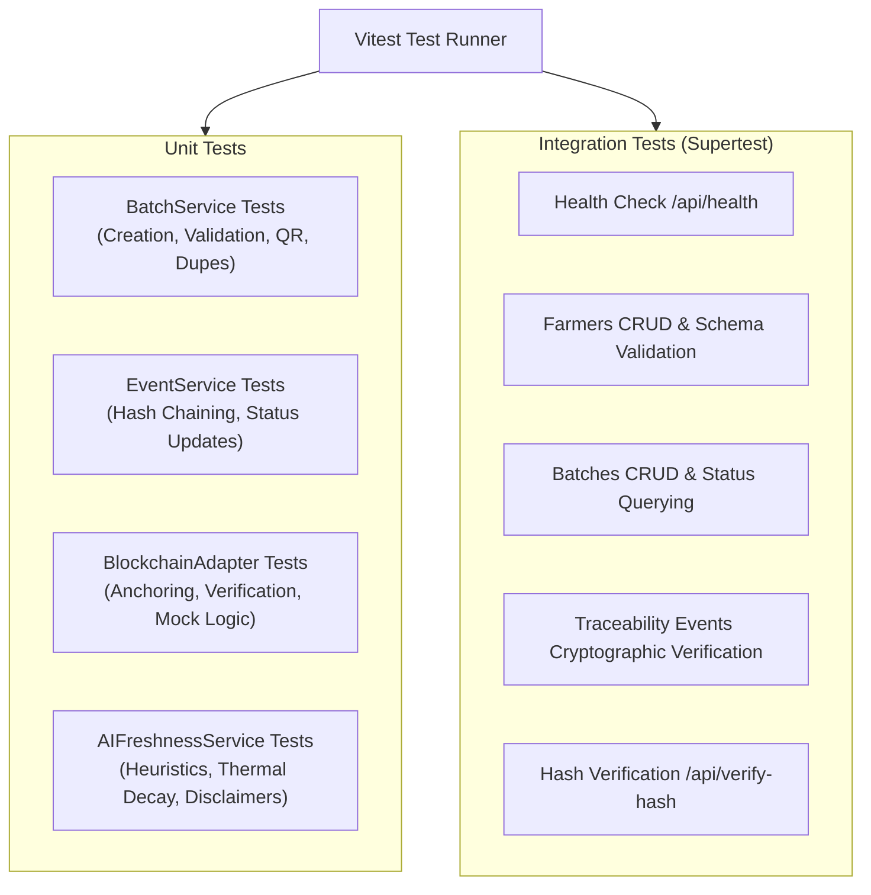

# AgriPassport Testing Strategy & Verification Guide

This document outlines the testing architecture, automated test suites, manual verification checklists, and quality assurance procedures for the AgriPassport repository.

---

## 1. Test Architecture Overview

The AgriPassport test suite utilizes **Vitest** and **Supertest** with an in-memory SQLite database (`:memory:`), providing fast, deterministic, and isolated execution without side effects on local development files.



---

## 2. Automated Test Suites

### A. Batch Management Unit Tests (`tests/unit/batch-service.test.ts`)
- **TC-BATCH-01**: Successfully registers a produce batch with all required metadata.
- **TC-BATCH-02**: Automatically generates an embedded Base64 QR code Data URL.
- **TC-BATCH-03**: Enforces uniqueness constraint and rejects duplicate batch identifiers.
- **TC-BATCH-04**: Rejects creation if the specified farmer ID does not exist in the database.
- **TC-BATCH-05**: Returns `null` when querying an unknown batch identifier.

### B. Event Service & Cryptographic Hashing Unit Tests (`tests/unit/event-service.test.ts`)
- **TC-EVT-01**: Successfully logs a supply chain checkpoint event (location, actor, role, temperature).
- **TC-EVT-02**: Computes deterministic SHA-256 hash chaining each event to its `previousRecordHash`.
- **TC-EVT-03**: Rejects adding an event to a nonexistent batch ID.
- **TC-EVT-04**: Automatically updates the parent batch's `currentStatus` according to the event stage.

### C. Blockchain Adapter Unit Tests (`tests/unit/blockchain-adapter.test.ts`)
- **TC-BC-01**: Anchors batch and event hashes to the local simulated Polygon Amoy registry.
- **TC-BC-02**: Generates realistic transaction hashes (`0x...`) and increments simulated block heights.
- **TC-BC-03**: Returns verified `true` when querying a valid anchored hash.
- **TC-BC-04**: Returns verified `false` and an audit error when querying an unanchored hash.

### D. AI Freshness Heuristics Unit Tests (`tests/unit/ai-freshness.test.ts`)
- **TC-AI-01**: Accurately computes high freshness score (Grade A) for newly harvested produce.
- **TC-AI-02**: Accurately models thermal acceleration: warm ambient exposure degrades shelf-life faster than cold chain.
- **TC-AI-03**: Confirms the presence of the mandatory non-laboratory decision-support disclaimer.

### E. End-to-End API Integration Tests (`tests/integration/api-endpoints.test.ts`)
- **TC-API-01**: `GET /api/health` returns HTTP 200 with active configuration mode.
- **TC-API-02**: `GET /api/farmers` returns seeded demonstration farmers.
- **TC-API-03**: `GET /api/batches` returns produce batches matching query criteria.
- **TC-API-04**: `GET /api/batches/:id` returns full digital passport with QR data and custody timeline.
- **TC-API-05**: `POST /api/batches` rejects payloads with missing fields (Zod validation).
- **TC-API-06**: `POST /api/batches` creates a valid batch and returns HTTP 201.
- **TC-API-07**: `POST /api/events` appends an event and updates cryptographic chain.
- **TC-API-08**: `POST /api/verify-hash` validates anchored record hashes.

---

## 3. Running the Automated Tests

### Run all tests once:
```bash
npm test
```

### Run tests in interactive watch mode:
```bash
npm run test:watch
```

### Expected Output:
```text
✓ tests/unit/ai-freshness.test.ts (2 tests)
✓ tests/unit/blockchain-adapter.test.ts (3 tests)
✓ tests/unit/batch-service.test.ts (4 tests)
✓ tests/unit/event-service.test.ts (3 tests)
✓ tests/integration/api-endpoints.test.ts (8 tests)

Test Files  5 passed (5)
     Tests  20 passed (20)
```

---

## 4. Manual End-to-End Verification Scenarios

| Step | User Action | Expected System Behavior |
| :--- | :--- | :--- |
| **1** | Open Dashboard (`http://localhost:5173`) | Statistics cards display active counts; 5 seeded batches render in grid. |
| **2** | Click "+ New Batch" | Navigation opens batch registration form with farmer dropdown populated. |
| **3** | Submit form with valid details | Digital passport is minted; user is redirected to passport page with dynamic QR code. |
| **4** | Click "Crate QR Tag" | High-resolution modal displays QR code with "Save PNG" and "Print Tag" buttons. |
| **5** | Click "Add Checkpoint" | Form opens with batch ID pre-filled; user logs a transit checkpoint with temperature. |
| **6** | Submit checkpoint | Timeline updates immediately showing the new event and its unique SHA-256 hash pill. |
| **7** | Click "Verify Hash" | Opens Ledger Explorer; shows green "Cryptographic Hash Match Verified" with block number. |
| **8** | Open "Verify QR" tab | Consumer portal allows searching by batch ID or clicking demo batch shortcuts. |
